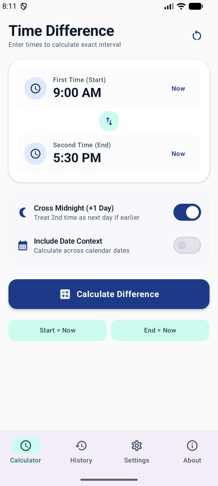
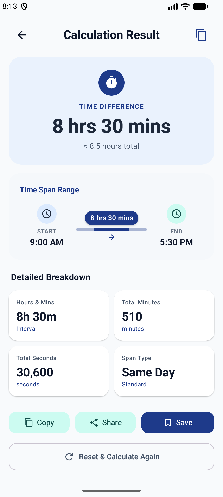
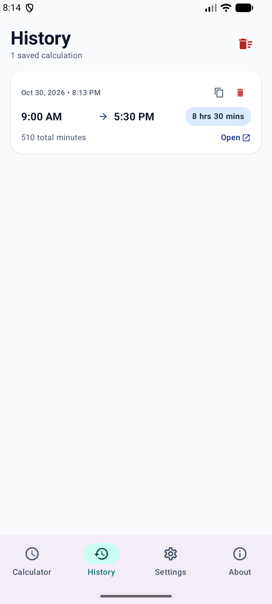

# ClockDiff ⏱️

[](https://android-arsenal.com/api?level=26)
[](https://kotlinlang.org)
[](https://developer.android.com/jetpack/compose)
[](LICENSE)

**ClockDiff** is a modern, intuitive, and feature-rich Android application built with **Jetpack Compose** and **Material Design 3**. It allows users to quickly and accurately calculate time differences, handle overnight spans crossing midnight, compute multi-day date durations, view visual timeline graphs, and manage a searchable history of past calculations.

---

## 📸 Screenshots

| Home Screen | Results & Timeline | Calculation History |
| :---: | :---: | :---: |
|  |  |  |

---

## ✨ Features

- ⏱️ **Exact Time Difference Calculation**: Instantly computes difference between two times in hours, minutes, total minutes, total seconds, and decimal hours (ideal for work/time-card logging).
- 🌙 **Cross-Midnight / Overnight Support**: Toggle or auto-detect overnight time spans (e.g., shifts starting at 10:00 PM and ending at 6:00 AM).
- 📅 **Multi-Day & Date Calculations**: Include custom start and end dates to compute duration across multiple days or weeks.
- 📊 **Visual Timeline Diagram**: Graphical representation of start time, end time, total span, and overnight indicators.
- 📜 **Searchable History**: Saved calculation logs with search capability, item deletion, full history clearing, and one-tap re-calculation.
- ⚡ **Quick Time Actions**: One-tap buttons to set start/end times to "Now", swap start & end times, or reset fields.
- 🎨 **Material 3 & Dark Theme**: Supports Light, Dark, and System Default themes with dynamic Material 3 components.
- ⚙️ **Customizable Preferences**: Configure 12-hour / 24-hour time formatting and default overnight calculation options.

---

## 🛠️ Tech Stack & Architecture

- **Language**: [Kotlin](https://kotlinlang.org/) (2.2.10)
- **UI Framework**: [Jetpack Compose](https://developer.android.com/jetpack/compose) with Material Design 3
- **Navigation**: Jetpack Navigation Compose
- **Architecture**: Clean Architecture / MVVM Pattern (Data, Domain, UI layers with `StateFlow` and `ViewModel`)
- **Persistence**: [Jetpack DataStore Preferences](https://developer.android.com/topic/libraries/architecture/datastore) (for settings and calculation history)
- **Asynchronous Flow**: Kotlin Coroutines & Flow
- **Build System**: Gradle with Version Catalogs (`libs.versions.toml`)

---

## 📂 Project Structure

```
ClockDiff/
├── app/
│   ├── src/
│   │   ├── main/
│   │   │   ├── java/com/example/clockdiff/
│   │   │   │   ├── data/            # Data models, DataStore preferences & Repository
│   │   │   │   │   ├── model/       # AppSettings, CalculationResult, ClockDiffHistoryItem
│   │   │   │   │   └── repository/  # ClockDiffRepository & DataStore Implementation
│   │   │   │   ├── domain/          # Business logic & time diff engine (ClockDiffCalculator)
│   │   │   │   ├── ui/              # Compose screens, components, theme & navigation
│   │   │   │   │   ├── components/  # Time/Date pickers, VisualTimeline
│   │   │   │   │   ├── navigation/  # Compose Navigation graph
│   │   │   │   │   ├── screens/     # Home, Results, History, Settings, About, Splash
│   │   │   │   │   ├── theme/       # Material 3 Color, Type, Theme definitions
│   │   │   │   │   └── viewmodel/   # ClockDiffViewModel & ClockDiffUiState
│   │   │   │   └── MainActivity.kt  # Single activity entry point
│   │   │   └── AndroidManifest.xml
│   │   └── test/                    # Unit tests for Calculator & History models
├── gradle/
│   └── libs.versions.toml           # Dependency version catalog
├── clockdiff_home.png               # App Home screenshot
├── clockdiff_results.png            # App Results screenshot
├── clockdiff_history.png            # App History screenshot
└── build.gradle.kts                 # Root Gradle build script
```

---

## 🚀 Getting Started

### Prerequisites

- **Android Studio**: Ladybug / 2024.2+ (or Android Studio Jellyfish / Koala)
- **JDK**: Java 11 or higher
- **Android Device / Emulator**: Running Android 8.0 (API level 26) or higher

### Building & Running

1. **Clone the Repository**:
   ```bash
   git clone https://github.com/abdullah-ateeq/ClockDiff.git
   cd ClockDiff
   ```

2. **Open in Android Studio**:
   Open Android Studio and choose **Open an existing project**, then select the `ClockDiff` folder.

3. **Build the Project**:
   ```bash
   ./gradlew assembleDebug
   ```

4. **Run Unit Tests**:
   ```bash
   ./gradlew test
   ```

---

## 📄 License

This project is licensed under the MIT License - see the [LICENSE](LICENSE) file for details.
